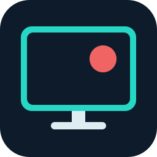

# DeskRec Buddy

Приложение для записи выбранной области экрана вместе с микрофоном и звуком компьютера. Сохраняет видео в MP4 и работает локально на Windows.

## Скачать

**Версия 1.0.0 · Windows 10 (2004 и новее) / Windows 11 · x64**

| Вариант | Загрузка |
| --- | --- |
| Установщик | [DeskRec-Buddy-1.0.0-setup.exe](https://github.com/RootforgeIO/DeskRec_Buddy/releases/download/v1.0.0/DeskRec-Buddy-1.0.0-setup.exe) |
| Портабл версия | [DeskRec-Buddy-1.0.0-portable.zip](https://github.com/RootforgeIO/DeskRec_Buddy/releases/download/v1.0.0/DeskRec-Buddy-1.0.0-portable.zip) |

[Все релизы](https://github.com/RootforgeIO/DeskRec_Buddy/releases) · [Контрольные суммы SHA-256](https://github.com/RootforgeIO/DeskRec_Buddy/releases/download/v1.0.0/SHA256SUMS.txt)

Python и FFmpeg уже включены в готовые сборки. Установщик работает для текущего пользователя без прав администратора и создаёт ярлыки на рабочем столе и в меню «Пуск». Для портабл версии распакуйте архив целиком в доступную для записи папку; ярлык можно создать кнопкой в приложении или командой `Create Desktop Shortcut.cmd`.

## Возможности

- Выбор области записи мышью, изменение размера и перенос рамки.
- Запись микрофона и всего звука выбранных колонок или наушников в один MP4.
- Общий режим WASAPI: микрофон остаётся доступен другим приложениям.
- Усиление голоса от 100% до 400% и ограничитель перегрузки.
- Три профиля качества, оценка размера и выбор папки для записей.
- Компактная полупрозрачная панель с таймером и кнопкой остановки.
- Остановка сочетанием **Ctrl+Shift+F9**.
- Восстановление завершённых фрагментов записи после аварийного завершения.

## Как записать видео

1. Запустите **DeskRec Buddy**.
2. Нажмите **Выбрать рамкой**, выделите область и отпустите кнопку мыши. Рамка зафиксируется автоматически. Для изменения области снова нажмите **Выбрать рамкой**; **Esc** отменяет изменение.
3. Выберите качество, устройство вывода звука, микрофон и папку сохранения. Усиление голоса по умолчанию — **200%**.
4. Нажмите **Начать запись**. Окно настроек свернётся, появятся красная рамка и плавающая панель. Панель можно перетащить за фон или таймер; её положение запоминается. Рамка и панель исключаются из записи.
5. Нажмите **Стоп** или **Ctrl+Shift+F9**. Кнопка **Стоп и сохранить** также доступна в основном окне через панель задач. После сохранения приложение покажет путь к MP4.

Чтобы записать собеседников и уведомления, выберите устройство, через которое воспроизводится их звук. Усиление голоса влияет только на запись DeskRec Buddy; громкость микрофона в Windows и других приложениях не меняется.

## Качество и размер

Видео кодируется в H.264, звук — в AAC. Качество выбирается до начала записи.

| Профиль | Кадры/с | Битрейт видео | Оценка за 40 минут |
| --- | ---: | ---: | ---: |
| Экономно | 24 | 1,6 Мбит/с | ≈ 530 МБ |
| Баланс | 30 | 2,6 Мбит/с | ≈ 840 МБ |
| Высокое | 30 | 4,5 Мбит/с | ≈ 1,4 ГБ |

Оценки учитывают звук. Фактический размер зависит от движения на экране и содержимого записи.

## Сохранение и восстановление

Запись сразу создаётся в выбранной папке как `DeskRec_дата_время.mp4`. При обычной остановке приложение завершает файл без повторного кодирования. Если плеер блокирует замену открытого файла, готовая копия сохраняется рядом с суффиксом `_saved`.

MP4 записывается фрагментами примерно по секунде. При следующем запуске приложение проверяет незавершённые записи в последней выбранной папке. После аварии могут потеряться последний незавершённый фрагмент и данные, оставшиеся в кэше операционной системы.

Настройки портабл версии находятся в `deskrec-settings.json` рядом с EXE, установленной — в `%LOCALAPPDATA%\DeskRec Buddy`. Удаление приложения сохраняет пользовательские записи и настройки.

## Ограничения

- Захват области поддерживается на основном мониторе.
- Защищённый рабочий стол Windows и эксклюзивный полноэкранный режим могут скрывать плавающую панель.
- Для записи созвона не переключайте звуковые устройства во время записи.
- Готовые сборки не имеют цифровой подписи.

## Запуск из исходников

Требуется Python 3.11 x64 и интерактивный рабочий стол Windows.

```powershell
python -m venv .venv
.\.venv\Scripts\python.exe -m pip install -r requirements.txt
.\.venv\Scripts\python.exe app.py
```

## Сборка

Портабл версия:

```powershell
.\build_portable.ps1
```

Для сборки установщика установите [Inno Setup](https://jrsoftware.org/isdl.php) 6.7+ или 7:

```powershell
.\build_release.ps1
```

Результаты появятся в `release/`. Версия задаётся в `product.py`, зависимости — в `requirements.txt` и `requirements-build.txt`. Регрессионные проверки находятся в `tests/`; аппаратным тестам нужны доступные звуковые устройства и рабочий стол Windows.

## Обратная связь

[Сообщить об ошибке](https://github.com/RootforgeIO/DeskRec_Buddy/issues). Укажите версию приложения, версию Windows и шаги для воспроизведения.

**Автор:** [RootforgeIO](https://github.com/RootforgeIO) · [rootforged.io](https://rootforged.io)

Сведения о сторонних компонентах и их лицензиях: [THIRD_PARTY.md](THIRD_PARTY.md).
